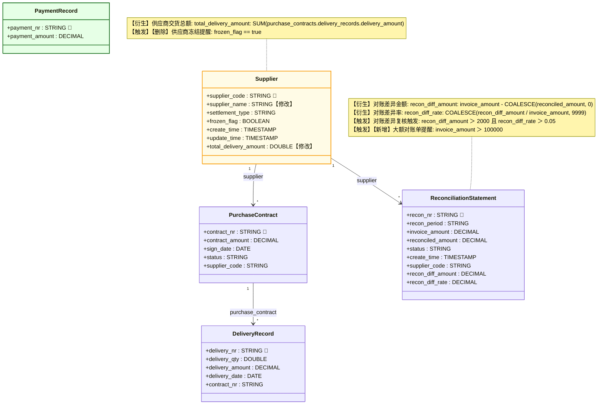

# 本体差异拓扑：supplier-recon（0.2.0-draft.1）

> 由 render_topology.py --diff 自动生成：target 相对 base（supplier-recon 0.1.0-draft.1）的差异，与 changeset.json 同一判定来源。
> 图例：绿 class=新增实体，红 class=删除，黄 class=有修改；成员行尾【新增】/【删除】/【修改】为属性级标记，
> 关联线标签尾【新增】/【删除】/【修改】为 links 级标记（持有方实体同步黄色高亮）。
> 取舍：Mermaid class 成员不支持删除线、classDiagram 的 linkStyle 渲染不生效（mermaid@11 实测），
> 删除项以红色 classDef 替代、links 变更以标签文字标记。

**变更摘要**：实体 新增 1 / 删除 0 / 修改 1；规则变更 2 条。

