# 本体拓扑：xgimi-rebuild（0.1.0-draft.1）

> 由 render_topology.py 从 DSL 自动生成；仅含实体 + links + 规则三要素，不含能力问题（CQ）。
> 图例：🔑 = 主键；关联线 `目标 "1" --> "*" 持有方 : 别名` = 持有方实体的 links 别名持有指向目标的引用；
> 【衍生】= derived_property（目标字段: 表达式）；【触发】= trigger 条件摘要（多条件合取）。

```mermaid
    classDiagram
    class Project {
        +project_code : STRING 🔑
        +project_name : STRING
    }
    class Material {
        +material_code : STRING 🔑
        +material_name : STRING
    }
    class BomLine {
        +bom_line_id : STRING 🔑
        +bom_type : STRING
    }
    class EcnRecord {
        +ecn_id : STRING 🔑
        +ecn_desc : STRING
    }
    class Demand {
        +demand_id : STRING 🔑
        +record_version : STRING 🔑
        +demand_type : STRING
    }
    class MaterialAuthorization {
        +project_code : STRING 🔑
        +material_code : STRING 🔑
        +auth_version : STRING 🔑
    }
    class Supply {
        +supply_id : STRING 🔑
        +supply_type : STRING
    }
    class StockMovement {
        +movement_id : STRING 🔑
        +movement_type : STRING
    }
    class Supplier {
        +supplier_code : STRING 🔑
        +supplier_name : STRING
    }
    class SupplierSupplyCondition {
        +supplier_code : STRING 🔑
        +material_code : STRING 🔑
    }
    class SubstitutionPermission {
        +permission_id : STRING 🔑
        +permission_type : STRING
    }
    class UnitConversion {
        +material_code : STRING 🔑
        +alt_unit : STRING 🔑
    }
    class CalculationRun {
        +run_id : STRING 🔑
        +branch : STRING
    }
    class ChangeRecord {
        +change_id : STRING 🔑
        +change_type : STRING
    }
    class ImpactRecord {
        +impact_id : STRING 🔑
        +review_status : STRING
    }
    class AllocationRecord {
        +allocation_id : STRING 🔑
        +allocated_qty : INTEGER
    }
    class SourcingSuggestion {
        +run_id : STRING 🔑
        +material_code : STRING 🔑
        +supplier_code : STRING 🔑
    }
    class VendorReferenceList {
        +run_id : STRING 🔑
        +supplier_code : STRING 🔑
        +list_status : STRING
    }
    class PeriodSupplyDemand {
        +run_id : STRING 🔑
        +material_code : STRING 🔑
        +period : STRING 🔑
    }
    class SlowMovingRisk {
        +run_id : STRING 🔑
        +material_code : STRING 🔑
        +risk_type : STRING
    }
    class SolutionPlan {
        +run_id : STRING 🔑
        +plan_code : STRING 🔑
        +action_type : STRING
    }
    class HistoricalCase {
        +case_id : STRING 🔑
        +evidence_status : STRING
    }
    class HistoricalMilestone {
        +case_id : STRING 🔑
        +milestone_type : STRING 🔑
        +milestone_date : DATE
    }
    class CauseAttribution {
        +case_id : STRING 🔑
        +cause_type : STRING 🔑
        +attributed_qty : INTEGER
    }
    class PreventionRule {
        +rule_id : STRING 🔑
        +rule_status : STRING
    }
    Material "1" --> "*" BomLine : 父项物料
    Material "1" --> "*" BomLine : 子项物料
    Project "1" --> "*" BomLine : 隶属项目
    EcnRecord "1" --> "*" BomLine : 产生于变更
    Project "1" --> "*" Demand : 归属项目
    Demand "1" --> "*" Demand : 被需求覆盖
    Demand "1" --> "*" Demand : 替换历史版本
    Project "1" --> "*" MaterialAuthorization : 授权项目
    Material "1" --> "*" MaterialAuthorization : 授权物料
    Material "1" --> "*" Supply : 供给物料
    CalculationRun "1" --> "*" Supply : 所属运行
    Material "1" --> "*" StockMovement : 收发物料
    Supply "1" --> "*" StockMovement : 来源供给
    Supplier "1" --> "*" SupplierSupplyCondition : 供货供应商
    Material "1" --> "*" SupplierSupplyCondition : 适用物料
    Material "1" --> "*" SubstitutionPermission : 被替代物料
    Material "1" --> "*" SubstitutionPermission : 替代物料
    Project "1" --> "*" SubstitutionPermission : 适用项目
    Material "1" --> "*" UnitConversion : 换算物料
    CalculationRun "1" --> "*" ChangeRecord : 所属运行
    BomLine "1" --> "*" ChangeRecord : 涉及BOM行
    SubstitutionPermission "1" --> "*" ChangeRecord : 涉及替代关系
    MaterialAuthorization "1" --> "*" ChangeRecord : 涉及授权
    CalculationRun "1" --> "*" ImpactRecord : 所属运行
    Project "1" --> "*" ImpactRecord : 受影响项目
    Material "1" --> "*" ImpactRecord : 受影响物料
    Demand "1" --> "*" AllocationRecord : 分配需求
    Supply "1" --> "*" AllocationRecord : 分配供给
    SubstitutionPermission "1" --> "*" AllocationRecord : 依据替代许可
    CalculationRun "1" --> "*" AllocationRecord : 所属运行
    Material "1" --> "*" SourcingSuggestion : 建议物料
    Supplier "1" --> "*" SourcingSuggestion : 建议供应商
    VendorReferenceList "1" --> "*" SourcingSuggestion : 列入参考清单
    CalculationRun "1" --> "*" SourcingSuggestion : 所属运行
    Supplier "1" --> "*" VendorReferenceList : 面向供应商
    CalculationRun "1" --> "*" VendorReferenceList : 所属运行
    Material "1" --> "*" PeriodSupplyDemand : 供需物料
    CalculationRun "1" --> "*" PeriodSupplyDemand : 所属运行
    Material "1" --> "*" SlowMovingRisk : 风险物料
    CalculationRun "1" --> "*" SlowMovingRisk : 所属运行
    SlowMovingRisk "1" --> "*" SolutionPlan : 处置风险
    Supply "1" --> "*" SolutionPlan : 调整供给
    CalculationRun "1" --> "*" SolutionPlan : 所属运行
    Project "1" --> "*" HistoricalCase : 历史项目
    Material "1" --> "*" HistoricalCase : 案例旧料
    Material "1" --> "*" HistoricalCase : 案例新料
    HistoricalCase "1" --> "*" HistoricalMilestone : 归属案例
    HistoricalCase "1" --> "*" CauseAttribution : 归属案例
    HistoricalCase "1" --> "*" PreventionRule : 源自案例
```

